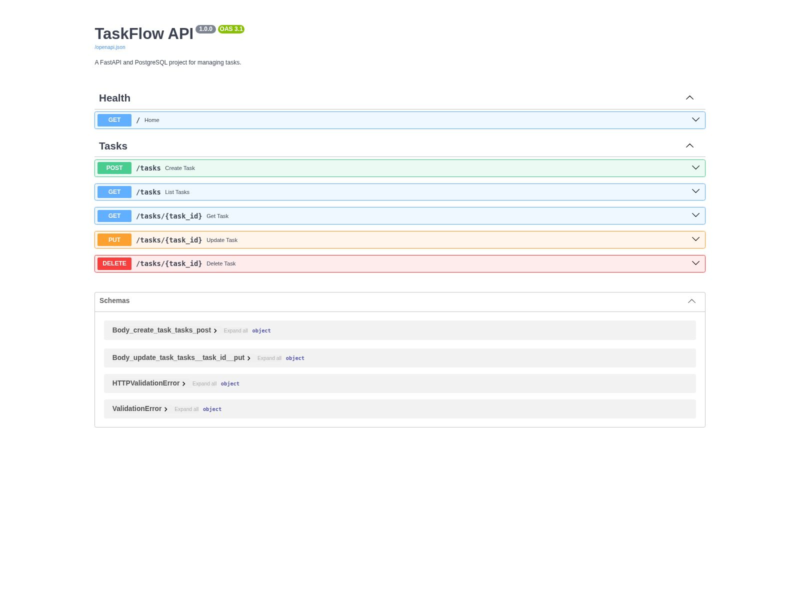
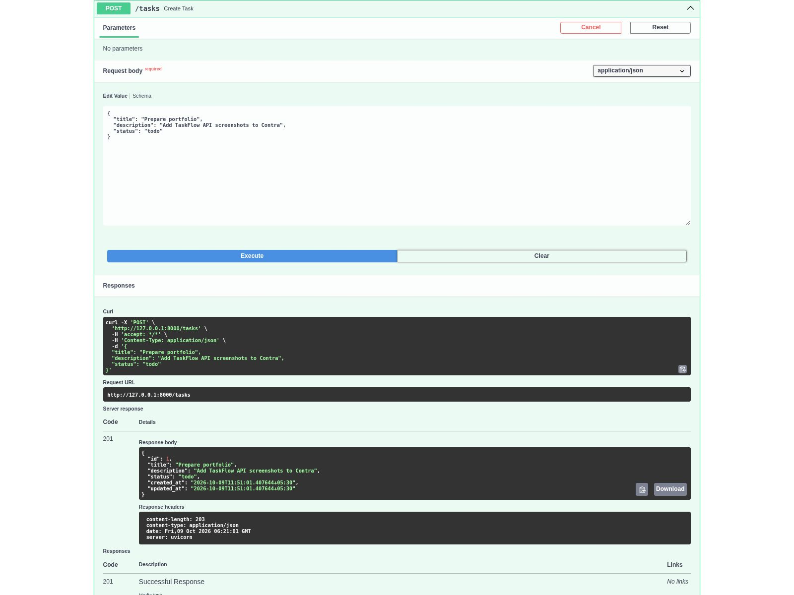
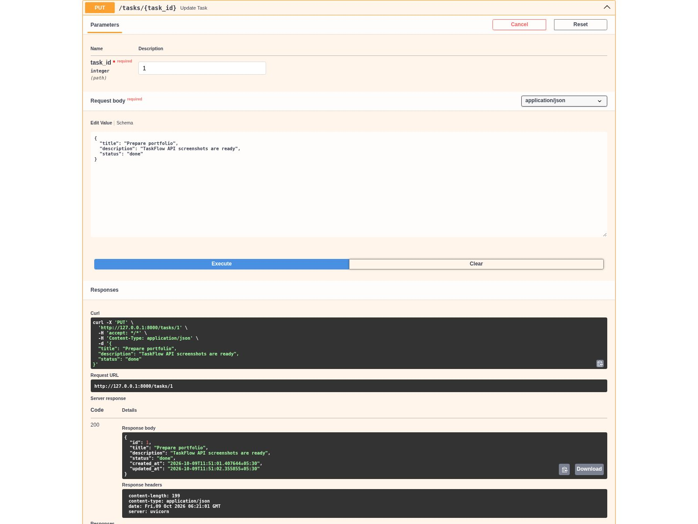
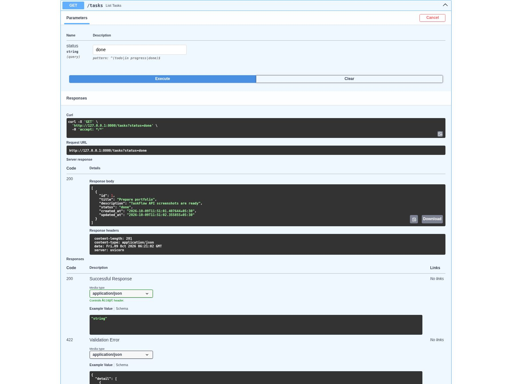

# TaskFlow API

A beginner-friendly task management REST API built with Python, FastAPI and PostgreSQL. Create tasks, track their status, update their details and delete completed work through interactive Swagger documentation.

## 1. Features

- Create a task with a title, description and status.
- List all tasks or filter them by status.
- Get one task by its ID.
- Update a task using a full replacement request.
- Delete a task by its ID.
- Store tasks in PostgreSQL with creation and update timestamps.
- Validate blank titles, field lengths and status values.
- Return 404 for missing tasks and 503 when PostgreSQL cannot be reached.
- Use parameterized SQL to keep request values separate from SQL commands.

Allowed statuses: `todo`, `in progress`, `done`.

This project uses simple functions, one database helper and a basic `for` loop. There are no custom classes, ORM models, async functions or comprehensions. The basic `str` and `int` annotations tell FastAPI how to validate request fields.

## 2. Tools

- Python 3.10 or later
- FastAPI
- PostgreSQL
- psycopg2-binary
- Uvicorn
- python-dotenv
- VS Code
- pgAdmin 4

## 3. Project Structure

```text
TaskFlow_API/
|-- main.py
|-- database.py
|-- schema.sql
|-- requirements.txt
|-- .env.example
|-- .gitignore
|-- README.md
|-- screenshots/
    |-- 01-docs.png
    |-- 02-create-task.png
    |-- 03-update-task.png
    |-- 04-status-filter.png
```

If you received text attachments, save each file without its final `.txt` delivery suffix. For example, rename `main.py.txt` to `main.py` and `README.md.txt` to `README.md`. Keep `requirements.txt` unchanged. Enable **View > Show > File name extensions** in Windows File Explorer so you can check the actual names.

## 4. Create the Database in pgAdmin

PostgreSQL must already be installed and its service running. Install Python and PostgreSQL first if you do not have them. During PostgreSQL installation, choose a password for the local `postgres` account and keep it private.

1. Open pgAdmin 4 and expand **Servers**.
2. Connect to your local PostgreSQL server using its local password.
3. Right-click **Databases > Create > Database**.
4. Enter `task_manager` as the database name and `postgres` as its owner. Click **Save**.
5. Select the new `task_manager` database and open **Tools > Query Tool**.
6. Open `schema.sql` in the Query Tool, then run its full contents with the Execute button or F5.
7. Refresh **Schemas > public > Tables**. You should see `tasks`.

The table must be created inside `task_manager`, not inside the default `postgres` database. You only need to run this setup once. Running `schema.sql` again does not delete existing tasks.

## 5. Windows Setup in VS Code

Open the `TaskFlow_API` folder in VS Code. Use **Terminal > New Terminal** and choose **PowerShell**. Run these commands from the project folder:

```powershell
py -m venv .venv
.\.venv\Scripts\python.exe -m pip install -r requirements.txt
Copy-Item .env.example .env
```

If `py` is not found but `python` works, use `python -m venv .venv` for the first command. Use Python 3.10 or later.

Open `.env` in VS Code and set your own local PostgreSQL password:

```dotenv
DB_HOST=localhost
DB_PORT=5432
DB_NAME=task_manager
DB_USER=postgres
DB_PASSWORD="your_actual_local_password"
```

Keep `.env` private. Never upload it to GitHub, include it in screenshots or send your password in chat. Only `.env.example`, which contains a placeholder, belongs in the repository. If your password contains `#` or spaces, keep it inside quotes. If it contains a double quote, use single quotes around the value instead.

The default PostgreSQL port is `5432`. If your installation uses another port, set that value in `.env`.

## 6. Run the API

From the project folder:

```powershell
.\.venv\Scripts\python.exe -m uvicorn main:app --reload
```

Open the address printed in your terminal, then add `/docs` to view Swagger UI. With the default command it is `http://127.0.0.1:8000/docs`.

Keep the terminal running while testing. Press `Ctrl+C` to stop the API. Restarting the API does not delete tasks because they are stored in PostgreSQL.

This command does not require activating the virtual environment, so there is no need to change PowerShell's execution policy.

## 7. API Endpoints

| Method | Path | Purpose |
| --- | --- | --- |
| GET | `/` | Check whether the API process is running |
| POST | `/tasks` | Create a task |
| GET | `/tasks` | List tasks, optionally filtered by status |
| GET | `/tasks/{task_id}` | Get one task |
| PUT | `/tasks/{task_id}` | Replace the task's editable fields |
| DELETE | `/tasks/{task_id}` | Delete a task |

The `/` endpoint does not check the database. Use `/tasks` to confirm database access.

## 8. Try the API in Swagger UI

### Create a task

Expand **POST /tasks**, click **Try it out**, paste this JSON and click **Execute**:

```json
{
  "title": "Prepare portfolio",
  "description": "Add TaskFlow API screenshots to Contra",
  "status": "todo"
}
```

A successful creation returns HTTP `201`, the generated ID and timestamps. Use the returned ID in the steps below; it may not be `1` on your machine.

### List and filter tasks

Expand **GET /tasks** and click **Try it out**. Leave `status` empty to list all tasks, or enter `todo`, `in progress` or `done` to filter the results. Click **Execute**. No matching tasks returns an empty list: `[]`.

### Get one task

Expand **GET /tasks/{task_id}**, enter the ID returned by the create request and click **Execute**.

### Update a task

Expand **PUT /tasks/{task_id}**, enter the same ID and send:

```json
{
  "title": "Prepare portfolio",
  "description": "TaskFlow API screenshots are ready",
  "status": "done"
}
```

PUT replaces the editable fields, not just the fields you changed. Always send the full body. If omitted, `description` becomes an empty string and `status` becomes `todo`. The ID and `created_at` remain unchanged; `updated_at` changes.

### Delete a task

Expand **DELETE /tasks/{task_id}**, enter the ID and click **Execute**. You should get HTTP `200` with `Task deleted.`. Fetching that ID again returns HTTP `404`.

## 9. Screenshots

These screenshots were captured from the running app against a real local PostgreSQL database, not mock data screens. Task IDs and timestamps will differ on your computer.

### API Documentation


### Create Task: HTTP 201


### Update Task: HTTP 200


### Status Filter: HTTP 200


## 10. Checks Performed

The project passed 21 HTTP checks against a real PostgreSQL 14 database, including create, list, filter, get, update, delete, missing IDs, invalid status, blank or oversized titles, oversized descriptions and wrong input types. A SQL injection-style title was stored as text without changing the table.

Also checked: tasks remain after the PostgreSQL server restarts, and the API returns HTTP `503` while the database is unavailable.

## 11. Troubleshooting

- **503 Database unavailable:** check that PostgreSQL is running and that `.env` has the correct database, user, password and port. Restart Uvicorn after editing `.env`.
- **relation "tasks" does not exist:** run `schema.sql` inside the `task_manager` database in pgAdmin.
- **404 Task not found:** use an existing task ID. A deleted task cannot be fetched again.
- **422 Validation Error:** check the title, status, field lengths and JSON body. Status values are case-sensitive.
- **Address already in use:** stop the other server or use `--port 8001`, then open that port's `/docs` address.
- **Module not found:** install requirements using the virtual environment's Python and run the server from the project folder.

## 12. Scope and Next Steps

This is a local learning and portfolio project. It has no user accounts, authentication, authorization, pagination, connection pool or production deployment setup. Anyone who can reach the API can edit its tasks. Do not expose it publicly or store sensitive information in it without adding access controls.

Possible next steps: login, due dates, priorities, pagination and automated tests.

## 13. References

- [FastAPI first steps and interactive docs](https://fastapi.tiangolo.com/tutorial/first-steps/)
- [psycopg2 SQL parameters and transactions](https://www.psycopg.org/docs/usage/)
- [PostgreSQL CREATE TABLE](https://www.postgresql.org/docs/current/sql-createtable.html)
